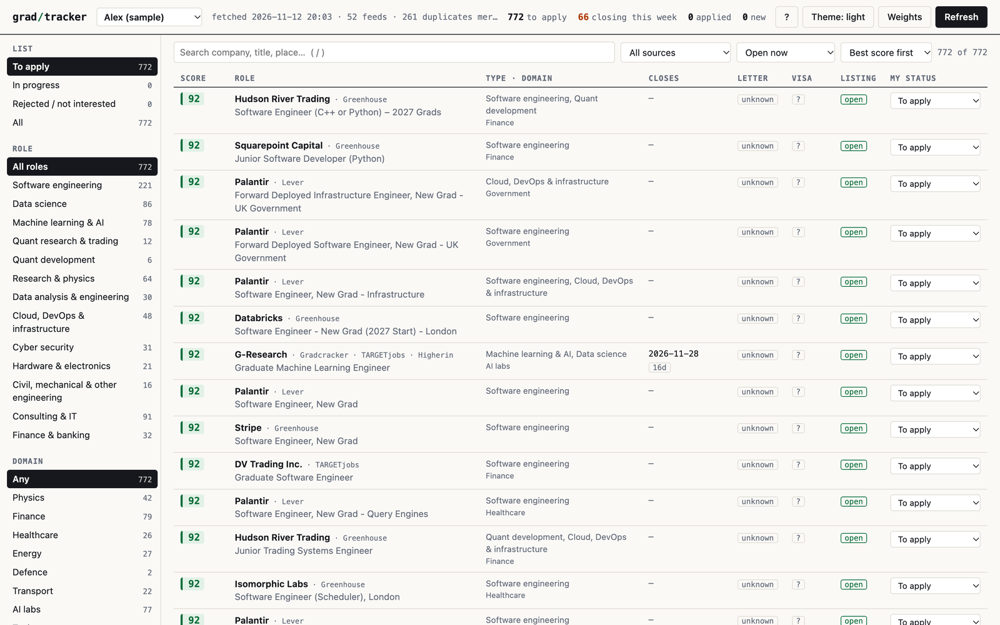
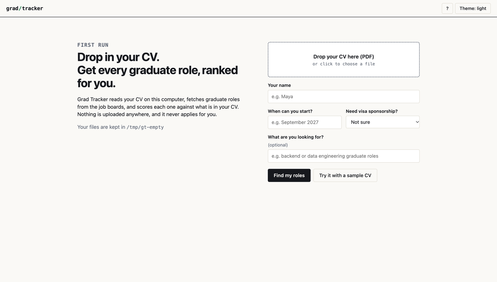
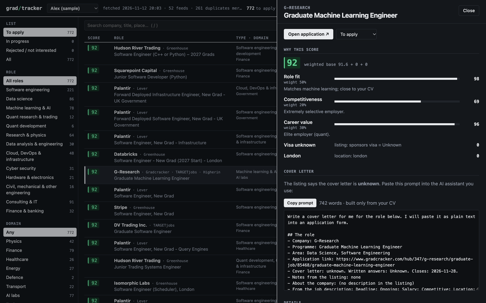

# grad/tracker

**Every UK graduate role in one list, ranked against your CV.** Runs on your laptop. No account, no API key,
no cost. It never applies for you.

[](https://github.com/sepehrvahedi/grad-tracker/actions/workflows/tests.yml)




Graduate roles are scattered across job boards and company career pages. The same role shows up three times,
deadlines pass while you are on another tab, and none of the boards know what is in your CV. Grad Tracker
fetches the roles, merges the duplicates, scores each one against your CV with rules you can read, and keeps
track of what you applied to.

## Try it in one command

You need Python 3.9 or newer. Nothing else.

```bash
git clone https://github.com/sepehrvahedi/grad-tracker && cd grad-tracker && ./run.sh demo
```

`demo` uses a fictional CV so you can look around first. When you are ready, run `./run.sh`, drop your own CV
(a PDF) into the page that opens, and wait about a minute for the first fetch.

| | |
|---|---|
| macOS / Linux | `./run.sh` (or double-click **Grad Tracker.command** on a Mac) |
| Windows | `run.bat` |
| Without cloning | `uvx --from git+https://github.com/sepehrvahedi/grad-tracker grad-tracker` |
| Installed as a tool | `pipx install git+https://github.com/sepehrvahedi/grad-tracker`, then `grad-tracker` |



## What you get

- **One list.** Roles from Gradcracker, TARGETjobs, Higherin, SheCanCode, jobs.ac.uk and the public job boards
  of about 45 employers (Greenhouse, Lever, Ashby). A typical fetch is 700 to 800 roles after merging duplicates.
- **A score you can argue with.** Every role gets 0 to 100 from three parts: role fit, how competitive you
  would be, and career value. Click a role to see each part, its weight and a one-line reason. Change the
  weights and the whole list re-ranks at once.
- **Red flags as caps, not surprises.** Internships, roles that start before you are available, roles that
  want a PhD or five years of experience: each one caps the score and says why.
- **Find by type and domain.** Software, data, ML, quant, hardware; physics, finance, healthcare, energy.
  Or type any word.
- **Your applications.** To apply, applied, interviewing, offer, rejected, not interested, plus notes. If a
  listing disappears, the roles you acted on stay.
- **Cover-letter briefs.** For roles that want a letter, a ready-made prompt built only from your CV, with
  strict honesty rules, to paste into the AI assistant you already use.
- **Keyboard first.** `j` `k` to move, `Enter` to open, `a` applied, `x` not interested, `/` search, `?` for the rest.



## Your data stays with you

Your CV is read on your machine and never sent anywhere. The only network requests are to the job boards, to
fetch public listings. Everything you add lives in plain files next to the code (or in `~/grad-tracker` when
installed as a tool), and none of it is tracked by git:

```
people/<you>/cv.pdf        your CV
people/<you>/person.yaml   what you are looking for (edit this to tune your ranking)
data/                      fetched roles, your statuses and notes
```

The page is served on `127.0.0.1` only, and it refuses requests that come from other websites.

## How the score works

No model, no embeddings service. One file, [`gradtracker/rules.py`](gradtracker/rules.py):

| Part | What it measures | Default weight |
|---|---|---|
| Role fit | How close the work is to your CV: role categories, your main skills, phrases you care about, and TF-IDF similarity between the listing and your CV | 50% |
| Competitiveness | How selective the employer is, adjusted for seniority, degree and clearance requirements | 20% |
| Career value | Employer reputation blended with role fit | 30% |

`score = weighted average + visa points + location points`, then capped by red flags (internship 25, starts
too early 35, off target 40, needs more experience 45). Every number in that sentence is a weight you can
change in the UI.

It works from the CV alone: [`cvprofile.py`](gradtracker/cvprofile.py) reads your strongest role
categories, years of experience, highest degree and main skills from the PDF. To steer it, add a `scoring:`
block to your `person.yaml`:

```yaml
available_from: September 2027
needs_visa_sponsorship: yes
scoring:
  great: [backend, distributed systems, platform]     # phrases that make a role ideal
  poor: [sales, support, consultant]                  # phrases to push down
  category_fit: {Data Science: 50, Software Engineering: 75}
  preferred_domains: [healthcare]
```

### Does a rule-based score hold up?

The first version of this tool asked an LLM for the three judgements. The 290 roles it scored for one real CV
are kept in [`tests/fixtures/benchmark`](tests/fixtures/benchmark) as a benchmark. Against that ranking, the
local scorer reaches a Spearman rank correlation of **0.83** with a tuned `person.yaml` and **0.72** from the
CV alone, in under a second and for nothing. A test fails if those drop below 0.78 and 0.60:

```bash
python -m pytest tests/test_rules.py -k benchmark
```

If you would still rather use a model, any OpenAI-compatible endpoint works: `pip install "grad-tracker[llm]"`
and set `GRADTRACKER_SCORER=llm`, `GRADTRACKER_LLM_API_KEY`, `GRADTRACKER_LLM_MODEL` (and
`GRADTRACKER_LLM_BASE_URL` for other providers) in `.env`.

## Sources

| Source | What it adds |
|---|---|
| Company job boards | Public Greenhouse, Lever and Ashby APIs for about 45 employers: trading firms, AI labs, big tech, science start-ups. UK roles only; graduate and junior titles, or every non-senior role for small teams |
| Gradcracker, TARGETjobs, Higherin | Graduate job boards (technology, data and software searches) |
| jobs.ac.uk | Data, ML and research-software roles at universities and institutes |
| SheCanCode | Graduate and junior roles from its job board |
| Adzuna (optional) | UK job search API. Add free keys from developer.adzuna.com to `.env` |
| Trackr (off by default) | Curated graduate programmes with deadlines, visa and cover-letter details. The `robots.txt` of Trackr's API asks automated clients to stay away, so this adapter is switched off. Only enable it if Trackr has told you that is fine for your use |

Each board's `robots.txt` was checked for the pages this reads, and requests identify themselves honestly.
To add an employer or change a search, copy
[`gradtracker/defaults/sources.yaml`](gradtracker/defaults/sources.yaml) to `sources.yaml` in your folder
and edit the copy. If one source fails, its roles from the last run are kept.

## Command line

```bash
grad-tracker                     # fetch, score, open the page
grad-tracker update              # fetch and score only
grad-tracker top -n 10           # best open roles as a table
grad-tracker top --json --closing-within 7
grad-tracker show <id>           # one role with its score breakdown
grad-tracker status <id> applied --note "referral from Sam"
grad-tracker add "Maya" ~/cv.pdf --available-from "September 2027" --visa yes
```

Several people can share one install (a flatmate, a friend): each folder in `people/` is one person with their
own CV, ranking and statuses.

## Use it from an AI assistant

[`skills/grad-jobs`](skills/grad-jobs/SKILL.md) is an agent skill built on the commands above. Copy the folder
into your assistant's skills directory (for Claude Code: `~/.claude/skills/grad-jobs`), then ask things like
"what should I apply to this week?" or "I applied to the Stripe one, note the referral".

The split is deliberate: the Python does the fetching and the scoring, so the numbers are the same every time
and you can read why. The assistant only does the talking. It is told never to invent a role, change a score
or apply for you.

## Development

```bash
python -m pip install -e ".[dev]"
python -m pytest            # offline tests, including the HTTP API on a real local socket
python -m pytest -m live    # also talks to the real job boards
```

No framework: the server is the standard library, the page is plain HTML, CSS and JavaScript.
Issues and pull requests are welcome, especially new sources and employer boards.

## Limits, honestly

- UK graduate roles only, and strongest for technology, data, quant and engineering roles.
- A score is a way to order a long list, not advice. Read the listing.
- Job boards change their pages. When a source breaks, the tool keeps its last results and tells you which one failed.

## Licence

MIT. The fictional CV in `gradtracker/examples` is made up; the benchmark CV is the author's own public CV.
